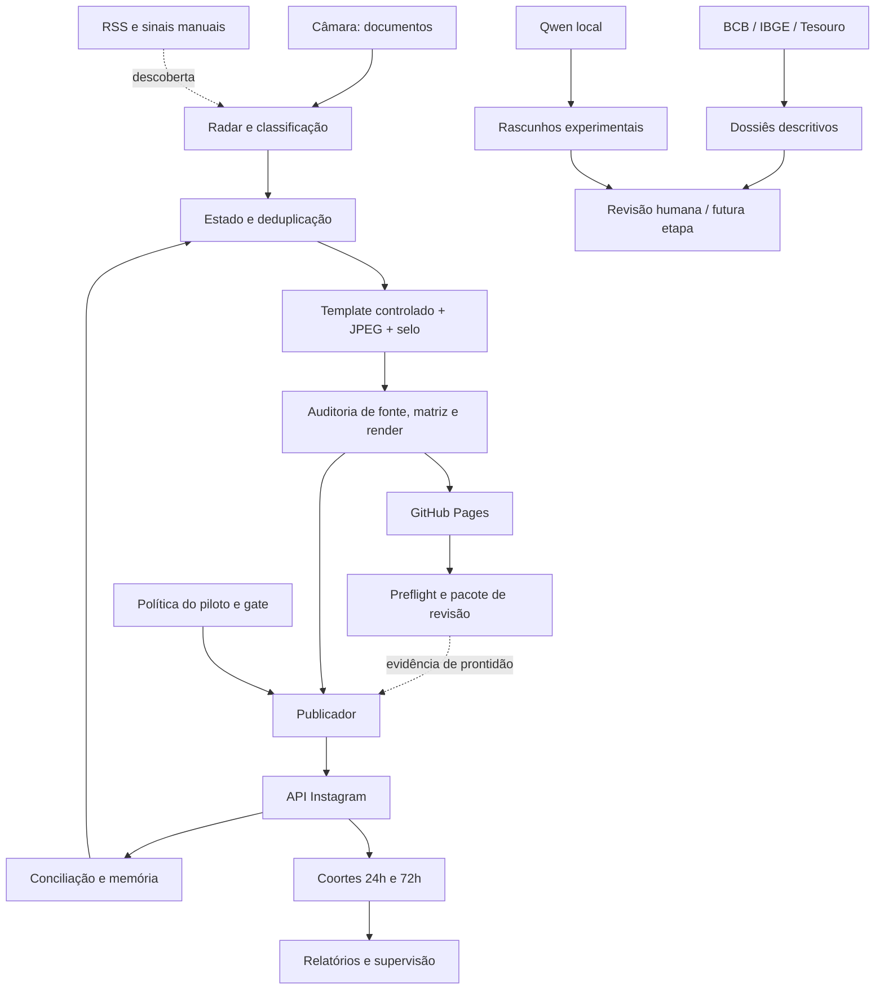

# FatoVia | Documentação técnica do produto

**Versão documental:** 1.0 · **Data-base:** 14/11/2026 · **Escopo:** motor editorial de @fato.via
**Público:** engenharia, segurança, operações, revisão editorial e manutenção.

> Documento de referência da implementação atual. Não é autorização para ampliar o piloto, nem certificação de segurança. Relatórios datados devem ser reconsultados antes de afirmar o estado operacional.

## 1. Propósito e fronteiras

O FatoVia reduz trabalho manual entre a identificação de documentos públicos e a divulgação de conteúdo educativo. Seu fluxo é orientado a evidências: coleta, priorização, redação controlada, renderização, revisão documental, verificação de publicação e medição. O perfil demonstrador opera em uma conta profissional de Instagram. A proposta comercial futura é adaptar a solução a equipes que precisam comunicar assuntos públicos de forma verificável; não há plataforma SaaS, onboarding multi-tenant, painel de clientes ou SLA implementados.

Princípios: neutralidade, atribuição, distinção entre proposta/lei/execução/resultado, não recomendar voto nem ranquear candidaturas, não automatizar acusações graves, não fabricar pauta para alcançar uma meta de frequência.

## 2. Arquitetura e limites de confiança



- Python 3.12 na CI; bibliotecas de `requirements.txt`; PIL/Pillow para renderização, chamadas HTTPS/JSON para fontes e Meta.
- GitHub Actions agenda os workflows; o GitHub é o armazenamento versionado de estado, relatórios e artefatos; GitHub Pages entrega JPEGs por HTTPS para ingestão da Meta.
- O publicador confia no parecer fresco e revalida a fonte e os arquivos efetivamente hospedados. O preflight é verificação e evidência de prontidão, não token de autorização por si só.
- A auditoria é um módulo funcional separado, sem credencial de publicação. Como código e dados compartilham repositório e mantenedores, não representa segregação forte de identidade, certificação independente ou cadeia de custódia inviolável.

## 3. Fontes e papel da evidência

| Fonte | Uso implementado | Limite |
|---|---|---|
| [Dados Abertos Câmara](https://dadosabertos.camara.leg.br/) | Identificação, ementa e tramitação de PL, PLP, PEC, PDL | Não prova aprovação, execução ou veracidade de alegações da proposição |
| Agência Brasil, Senado e IBGE (notícias/RSS) | Descoberta de temas e desempate | Disponibilidade variável; não autoriza fatos ou posts |
| Explore Instagram | Ingestão manual de links via workflow | Não acessa feed personalizado nem tendências privadas |
| [BCB SGS](https://dadosabertos.bcb.gov.br/) | Série 432, meta Selic; 16122, núcleo IPCA | Frequências e unidades distintas; contexto |
| [SIDRA IBGE](https://sidra.ibge.gov.br/) | Tabela 1737/variável 63; 4099/variável 4099 | IPCA mensal e PNAD trimestral; não comparar períodos incompatíveis |
| [Siconfi Tesouro](https://apidatalake.tesouro.gov.br/ords/cdwhprd/siconfi/tt/rreo) | RREO Anexo 01 União, células de despesas e dotação | Sem somar subtotal com total ou inferir resultado social |
| [Instagram API](https://developers.facebook.com/docs/instagram-platform/) | Conta, publicação, histórico recente e insights | Disponibilidade, permissões, limites e dados da Meta |

A coleta econômica valida identidade, período, unidade, formato, duplicatas, completude quando aplicável e SHA-256 da resposta. Valores ausentes não equivalem a zero. Dossiês sobre inflação, juros, desocupação e execução orçamentária são descritivos; não demonstram causalidade nem são enviados ao Instagram. DOU, TCU, CGU e Portal da Transparência não estão integrados no motor atual.

## 4. Mapa de módulos

| Arquivo em fatovia/ | Responsabilidade |
|---|---|
| `engine.py`, `__main__.py`, `memory.py` | Radar, regras, score de pauta, estado, CLI |
| `evidence.py` | Selo SHA-256 de projeção editorial, fonte permitida e reconsulta |
| `render.py`, `healthcheck.py` | Template de marca, sete JPEGs, legenda, teste técnico |
| `claim_matrix.py`, `editorial_audit.py` | Vínculo com trechos, limites, reconstrução, parecer e verificação de bytes |
| `preflight.py`, `review_pack.py` | Simulação sem POST; artefato com originais, montagem e conteúdo |
| `publisher.py`, `pilot.py` | Gate, elegibilidade, quotas, checkpoint, envio e conciliação |
| `research.py`, `ibge.py`, `budget.py`, `investigation.py` | Coleta e dossiês de pesquisa |
| `local_draft.py`, `claim_audit.py` | Laboratório Qwen2.5 1.5B com saída JSON e triagem, sem autorização |
| `analytics.py`, `cohorts.py`, `discovery.py`, `pilot_report.py` | Métricas, sinais editoriais e acompanhamento |

## 5. Pipeline de ponta a ponta

1. **Detectar:** buscar documentos recentes; detalhe oficial e fallback de tramitações, com limites e diagnóstico. Descartar fontes inválidas, material fora do escopo, ementa insuficiente, repetição e renovação individual rotineira de radiodifusão. Elegibilidade exige andamento de até 14 dias. A fila tem até 8 itens; a varredura prepara até 4 conforme vagas.
2. **Selecionar:** pontuação determinística por recência, diversidade, especificidade e relevância temática, com sinais de descoberta no desempate. Limiar 55 e deduplicação por ID/versão e similaridade textual; não é detecção semântica universal.
3. **Produzir:** gerar carrossel de 7 cards 1080 × 1350, legenda, link à fonte e identificador editorial. Tema específico quando há âncoras literais do template; fallback genérico. A ementa é atribuída, não tratada como fato consumado. Paleta #123E31, #F5F1E7 e #B5D39F, conforme [governança](EDITORIAL_GOVERNANCE.md).
4. **Selar e revisar:** SHA-256 do conteúdo editorial, matriz de afirmações vinculadas à origem, reconsulta da Câmara, reconstrução determinística dos cards e comparação da legenda e dos hashes. Parecer válido por até 24 horas. Trata-se de auditoria documental limitada, não de verificação universal de fatos.
5. **Hospedar e testar:** Pages publica apenas `docs/`. Preflight verifica formato, dimensões/decodificação, trilha de auditoria, fonte atual e equivalência binária JPEG. Produz pacote visual como artefato do Actions (retenção configurada em 7 dias).
6. **Autorizar e publicar:** exige `IG_PUBLISH_ENABLED=true`, credencial e conta corretas, política do piloto válida, pauta permitida por identidade/versão/hash, horário e quotas. Verifica duplicidade por marcador no histórico recente da Meta, registra checkpoint no Git antes de enviar, cria 7 contêineres e um pai carrossel, aguarda disponibilidade e publica. Grava media_id e permalink quando disponível. Falha de resposta incerta bloqueia repetição cega; reconciliar antes de qualquer nova tentativa.
7. **Medir:** coletar alcance, salvamentos, compartilhamentos e visualizações quando disponíveis; janelas [24h,31h) e [72h,79h). Excluir amostras incompletas dos cálculos comparáveis, registrar janelas perdidas. O relatório de aprendizagem exige 20 amostras elegíveis de 72h (alcance ≥ 20) para análise descritiva; não altera a cadência sozinho.

## 6. Workflows e cadência

Horários BRT (UTC-3); agendamento nominal, não SLA. Workflows de geração podem executar também por push de código ou disparo manual, conforme YAML.

| Workflow | Cadência / função |
|---|---|
| [editorial.yml](.github/workflows/editorial.yml) | 02h17, 08h17, 14h17, 20h17; radar, testes, fila |
| [editorial-audit.yml](.github/workflows/editorial-audit.yml) | Chamado após radar; revisão documental |
| [pages.yml](.github/workflows/pages.yml) | Deploy após radar bem-sucedido ou mudança aplicável |
| [preflight.yml](.github/workflows/preflight.yml) | Após Pages ou disparo previsto; sem POST |
| [publish.yml](.github/workflows/publish.yml) | Verificação horária :12, 08h a 22h; apenas janelas permitidas |
| [intelligence.yml](.github/workflows/intelligence.yml) | 03h43, 09h43, 15h43, 21h43; descoberta, insights, piloto |
| [research.yml](.github/workflows/research.yml) | 10h25; BCB, RREO, IBGE e dossiês |
| [meta-credentials.yml](.github/workflows/meta-credentials.yml) | 10h37; saúde e renovação dentro do limiar de 15 dias, se habilitada |
| [local-ai.yml](.github/workflows/local-ai.yml) | Laboratório sob demanda ou alteração aplicável; pesos/runtime com SHA fixo |
| [instagram-auth-check.yml](.github/workflows/instagram-auth-check.yml) | Checagem de conta, gate e quota, somente GET |
| [explore-intake.yml](.github/workflows/explore-intake.yml) | Ingestão manual de sinais públicos |

O grupo `fatovia-state` coordena mutações de fila/publicação/insights. Outros workflows usam grupos próprios e reconciliação Git; conflitos ainda podem exigir intervenção. Atrasos/cancelamentos do GitHub podem ocasionar janelas perdidas. Não há garantia de publicação ao minuto.

## 7. Estado, trilha e formatos

| Artefato | Contrato / uso |
|---|---|
| `data/state.json` | Fila pending, publicados, transação publishing e amostras de métricas |
| `data/last_report.json` | Resultado do radar; o campo publication=DISABLED refere-se ao radar, que jamais envia, não ao gate geral |
| `data/editorial_audit.json` | Parecer por ID/versão, matriz, hashes, instante e razões |
| `docs/media/camara-<id>/<versão>/01..07.jpg` | JPEGs públicos, vinculados por hashes; não constituem post |
| `docs/manifest.json` | Catálogo técnico, não o feed do Instagram |
| `data/economic_context.json`, `data/budget_context.json`, `data/ibge_context.json` | Séries/células e metadados validados de pesquisa |
| `data/investigation_report.json` | Dossiês não autorizados a publicar |
| `data/discovery_report.json`, `data/learning_report.json` | Sinais de pauta e resumo de coortes |
| `data/pilot_policy.json`, `data/pilot_report.json` | Janela e lista de autorização, contagem, avaliação e pendências |
| `data/meta_token_lifecycle.json` | Metadados de ciclo de vida, não token |

Os artefatos do preflight guardam `preflight_report.json`, pacote de JPEGs/legendas e commit da execução. Não inferir ausência de erro a partir de relatório antigo. O estado local registra somente mídia registrada no motor, não é inventário integral do Instagram.

## 8. Operação e segurança

**Configuração:** [INSTAGRAM_SETUP.md](INSTAGRAM_SETUP.md). Secrets: `META_ACCESS_TOKEN`; `META_SECRET_ROTATOR` se renovação habilitada. Variables: `META_IG_USER_ID`, `META_API_HOST` (opcional), `IG_PUBLISH_ENABLED`, `META_ROTATION_ENABLED`, `METRICS_ENABLED` (coleta opcional do radar; intelligence tem coleta própria). Nenhum valor sensível deve ser gravado em código, issue, log ou documentação. Use identidade de menor privilégio, restrinja escrita e revise mudanças em workflows. A conta permitida está fixada no código; adaptar para terceiros exige configuração e revisão de isolamento, não apenas mudar token.

**Interrupção:** definir `IG_PUBLISH_ENABLED=false`. Uma chamada já em curso pode continuar; avaliar cancelamento operacional com cuidado. Não remover arbitrariamente `publishing` ou repetir POST. Consultar log, conta e marcador exato, preservar evidências e decidir recuperação. Em falha editorial após envio, revisar, registrar impacto e obter decisão de correção; não apagar ou republicar automaticamente. Se fonte indisponível ou mídia divergente, manter bloqueio. Se insights faltarem, não inventar métricas.

**Credenciais:** o mecanismo de renovação está implementado e o teste de saúde passou; a renovação efetiva da credencial Meta ainda não foi exercitada. Expiração do acesso a dados e do rotador podem exigir ação manual. Monitore os prazos sem expor credenciais.

**Supervisão:** existe acompanhamento diário externo ao repositório (ChatGPT/GitHub/Gmail) configurado para alertar por exceção; a entrega efetiva ainda não foi testada. Não há serviço de envio de e-mail autônomo incorporado ao Python do FatoVia.

**Riscos residuais:** repositório público, compartilhamento de privilégios, código/auditoria modificáveis pelo mesmo mantenedor, janelas de coleta não garantidas, transação ambígua/reconciliação com busca recente, estado parcialmente histórico, versões externas sujeitas a mudanças, hashes não provam verdade ou autoria. Não usar com dados pessoais/clientes sem arquitetura isolada, política de retenção, controles de acesso, revisão de privacidade e testes específicos. Sem SLA, auditoria externa certificada ou garantia legal.

## 9. Testes e evidências (14/11/2026)

| Evidência | Resultado observado |
|---|---|
| [Radar 43640180366](https://github.com/thayanneoliveira/Fatovia/actions/runs/43640180366) | 112 testes aprovados na suíte do repositório (inclui outros módulos de auditoria), radar concluído |
| [Preflight 43639559303](https://github.com/thayanneoliveira/Fatovia/actions/runs/43639559303) | 8 carrosséis/56 JPEGs; 5 verificações por carrossel; nenhum POST |
| [Auth 43639888649](https://github.com/thayanneoliveira/Fatovia/actions/runs/43639888649) | Gate habilitado, autenticação @fato.via, quota consultada |
| [Instagram 43631607079](https://github.com/thayanneoliveira/Fatovia/actions/runs/43631607079) | Publicação experimental anterior, fora do piloto |
| [Pesquisa 43639028958](https://github.com/thayanneoliveira/Fatovia/actions/runs/43639028958) | Quatro dossiês, sem autorização editorial |
| [IA local 43639241287](https://github.com/thayanneoliveira/Fatovia/actions/runs/43639241287) | 4/4 casos estruturais; inspeção posterior detectou presunções de situação legal |
| [Monitoramento 43640179826](https://github.com/thayanneoliveira/Fatovia/actions/runs/43640179826) | Execução bem-sucedida; relatório inicial aguardando início |

## 10. Validação local e evolução

```bash
python -m pip install -r requirements.txt
python -m unittest discover -s tests -v
python -m fatovia report
python -m fatovia demo
python -m fatovia scan
python -m fatovia.editorial_audit
python -m fatovia.preflight
python -m fatovia.pilot_report
```

Comandos escrevem arquivos locais, conforme módulo; isole checkout e credenciais. `python -m fatovia.publisher status` e `probe` não publicam. Use o workflow autorizado para `prepare/deliver/reconcile`; não execute POST manual. Para pesquisa: `python -m fatovia.research`, `python -m fatovia.budget`, `python -m fatovia.ibge`, `python -m fatovia.investigation` em sequência. O laboratório local exige runtime/modelo e endpoint isolado, conforme workflow.

**Piloto:** ativação confirmada em 14/11; janela 15–21/11, máximo 4 no total, 2 por dia (09h/17h). Relatório inicial: 0 publicados e 0 coortes. Encerrar automaticamente por prazo ou teto, sem promoção automática. A segunda etapa planejada é um experimento de 30 dias, com até 4/dia, 120 potenciais, condicionado a nova autorização e avaliação. Depois: aprendizagem estatística adequada, revisão editorial, diversificação de fontes e formatos, políticas de correção, isolamento multi-conta/ambiente, contratos de disponibilidade e governança para clientes. Não prometer viralização, custo zero permanente, suporte abrangente ou conformidade certificada.

## 11. Manutenção da documentação

Atualizar esta referência em alterações de fontes, schema, modelo, política, agendamento, controle de publicação ou go-live. Revisar evidências de cada marco e registrar limitações. Para a operação real, YAML e política versionada prevalecem sobre exemplos; o gate administrativo permanece externo. Este repositório público não contém licença expressa no nível raiz observado nesta data. Definir termos de comercialização e licenciamento antes de distribuir ou adaptar a terceiros.
