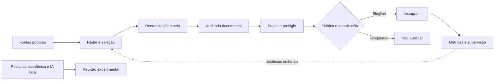

# FATOVIA

**Informação antes de opinião.** Motor de inteligência editorial e divulgação de políticas públicas, com rastreabilidade documental, publicação controlada e medição de desempenho.

O FatoVia coleta documentos públicos, identifica pautas, transforma registros em carrosséis explicativos e verifica a origem e a integridade do conteúdo antes de permitir a publicação. A finalidade é educação cívica e transparência, não recomendação eleitoral.

[Perfil demonstrador @fato.via](https://www.instagram.com/fato.via/) · [Documentação técnica](DOCUMENTACAO_TECNICA.md) · [Governança editorial](EDITORIAL_GOVERNANCE.md) · [Piloto](PILOT.md)

## Estado do produto | 14/11/2026

**Protótipo funcional de conta única, com piloto documental autorizado e ainda sem publicações do piloto registradas.** A validação da credencial e da chave de publicação retornou sucesso. A primeira publicação programada está prevista para 15/11, condicionada aos controles e à disponibilidade da infraestrutura.

| Capacidade | Estado |
|---|---|
| Radar da Câmara, seleção, memória e renderização | Implementado e testado |
| Auditoria documental, hashes e verificação da mídia pública | Implementado e testado; segregação funcional |
| Meta Instagram Login e publicação | Uma publicação experimental comprovada; piloto agendado |
| Pesquisa BCB, IBGE, Tesouro | Coleta testada; quatro dossiês de pesquisa sem autorização de postagem |
| Laboratório Qwen local | Experimental, isolado da publicação |
| Métricas em 24/72 h | Coleta implementada; amostra insuficiente para otimização |
| Alerta por exceção | Automação externa ao GitHub configurada; entrega de e-mail não testada |
| Experimento de 30 dias / multi-conta / SaaS | Não liberado / não implementado |

Evidências de validação: [112 testes](https://github.com/thayanneoliveira/Fatovia/actions/runs/43640180366), [preflight de 8 carrosséis e 56 JPEGs](https://github.com/thayanneoliveira/Fatovia/actions/runs/43639559303), [autenticação e gate](https://github.com/thayanneoliveira/Fatovia/actions/runs/43639888649), [publicação experimental](https://github.com/thayanneoliveira/Fatovia/actions/runs/43631607079).

## Como funciona



A saída experimental **não** alimenta o publicador. O piloto admite até quatro carrosséis no total, dois por dia, 09h e 17h, entre 15 e 21/11/2026, estritamente vinculados aos hashes aprovados. O objetivo posterior de quatro publicações diárias por 30 dias não está autorizado pelo piloto.

## Executar em ambiente de desenvolvimento

Python 3.12 é a versão usada na CI. Use um checkout isolado, sem tokens reais e com publicação desativada.

```bash
python -m pip install -r requirements.txt
python -m unittest discover -s tests -v
python -m fatovia report
python -m fatovia demo
python -m fatovia scan
python -m fatovia.editorial_audit
python -m fatovia.preflight
```

`scan` e a auditoria consultam fontes oficiais e escrevem arquivos locais; o preflight consulta os JPEGs hospedados. Nenhum desses comandos publica no Instagram. Veja a [configuração do Instagram](INSTAGRAM_SETUP.md) antes de operar a conta real.

## Navegação no repositório

- [DOCUMENTACAO_TECNICA.md](DOCUMENTACAO_TECNICA.md): arquitetura, módulos, fluxo, operação, segurança, evidências, limitações.
- [EDITORIAL_GOVERNANCE.md](EDITORIAL_GOVERNANCE.md): identidade visual e política editorial.
- [INSTAGRAM_SETUP.md](INSTAGRAM_SETUP.md): credenciais, controles, recuperação.
- [PILOT.md](PILOT.md): escopo e avaliação operacional.
- `fatovia/`: motor editorial; `tests/`: testes; `data/`: estado e relatórios públicos; `docs/`: mídia pública e índice técnico.
- `auditoria/` e workflows eleitorais são uma linha de pesquisa separada: não integram o fluxo de publicação do produto.

## Segurança, custo e uso

O repositório é público e não deve conter segredos, dados pessoais ou dados de clientes. A operação atual utiliza infraestrutura e recursos gratuitos quando disponíveis; custos, limites e termos dependem dos provedores. Não há SLA ou garantia de alcance/viralização. Acesso público ao código não implica concessão de licença comercial ou autorização de redistribuição. Para adoção por terceiros, definir escopo, propriedade, condições de uso e isolamento antes de qualquer implantação.

**Sem fonte verificável, não publicar. Proposta não equivale a lei, execução ou resultado.**
